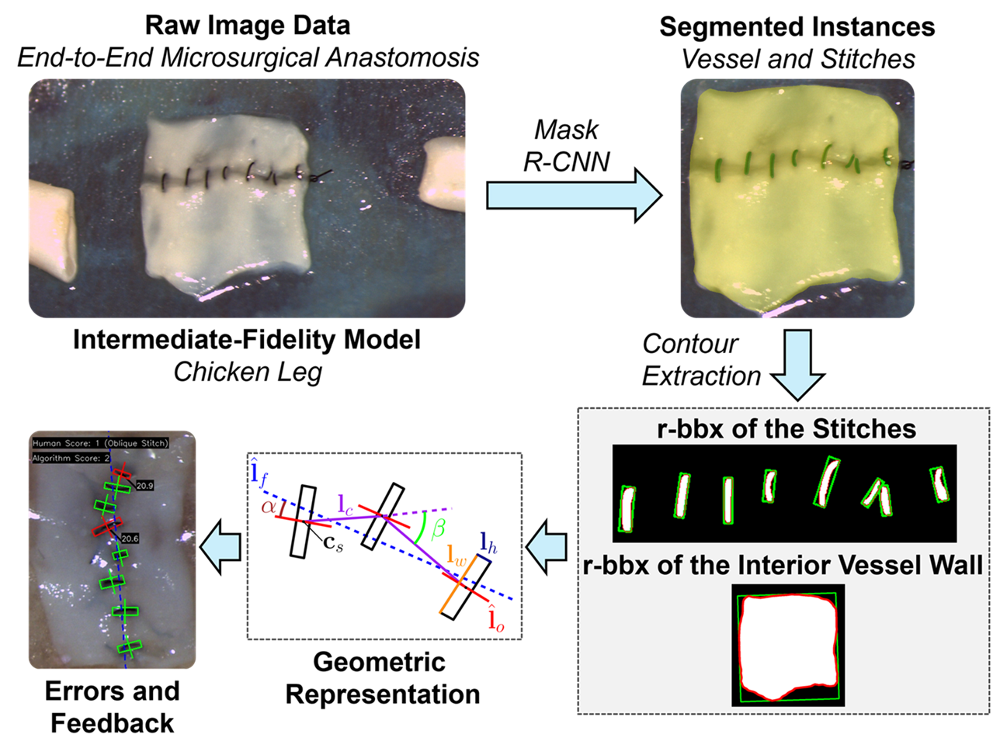
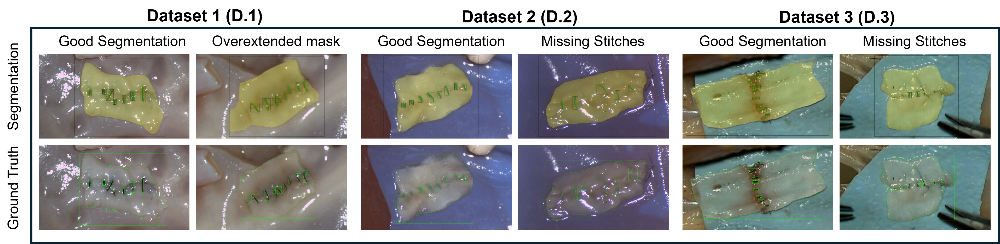
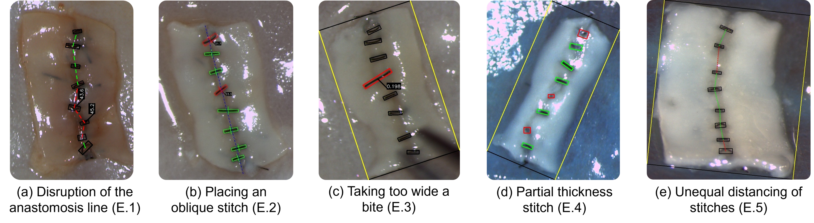

# Quantitative Assessment of Skills and Acquisition in Microsurgery  
*Official code for EMBC 2025 (in press)*

This repository contains the training, inference, and analysis code for our paper accepted to **EMBC 2025**.
---
  

## Installation

We recommend using **conda** to create a clean environment:

```bash
# 1) Create new env
conda create -n autoAli python=3.10 -y
conda activate autoAli

# 2) Install PyTorch
pip install torch torchvision --index-url https://download.pytorch.org/whl/cu121
# CPU only:
# pip install torch torchvision --index-url https://download.pytorch.org/whl/cpu

# 3) Install the rest of the dependencies
pip install -r requirements.txt
```

---

## Usage

The workflow has three main steps: **Training**, **Inference**, and **Postprocessing**.  
Figures and visual examples are provided in the [`imgs/`](imgs/) folder.

---

## Data

- 50 high quality anastomosis images with annotations
- Input datasets should follow **COCO format** with `_annotations.coco.json`.  
- Expected folder layout:

```
data/
└── 5_fold_cross_no_val_balanced/
    ├── fold_1/
    │   ├── image1.jpg
    │   ├── image2.jpg
    │   └── _annotations.coco.json
    ├── fold_2/
    └── ...
```
---

### 1. Training (5-fold cross-validation)
Train a Custom Mask R-CNN on 5 folds of the dataset:

- Unzip images in 'data/5_fold_cross_no_val_balanced.zip'
- Adjust `BATCH_SIZE`, `MAX_EPOCHS`, or `BACKBONES` inside `train.py`.  
- Checkpoints are saved in `lightning_logs/version_x/checkpoints/`.

```bash
python train.py
```

---

### 2. Inference
Run inference on one fold with a trained checkpoint:

```bash
python inference.py
```

- Produces:
  - `_infer/` folder with predicted overlays (`.png`)  
  - Cropped masks of sutures & vessels  
  - A JSON file with evaluation metrics  

Inference visualization  
  

---

### 3. Postprocessing & ALI Analysis
Compute surgical error metrics (ALI scores) and save visualization figures:

```bash
python postprocess.py
```

- Loads saved inference results + ground truth annotations  
- Produces per-error visualizations (`output_ALI_1/`, `output_ALI_3/`, etc.)  
- Errors analyzed:
  - Mistake 1: Line Disruption  
  - Mistake 3: Oblique Stitch  
  - Mistake 4: Too Wide Bite  
  - Mistake 5: Partial Thickness  
  - Mistake 6: Unequal Distancing  

ALI Error Visualization  
  


## Citation

If you use this code, please cite our paper:

```
@inproceedings{hu2025quantitative,
  author    = {Luyin Hu, Soheil Gholami, George Dindelegan, Torstein R. Meling, and Aude Billard},
  title     = {Quantitative Assessment of Skills and Acquisition in Microsurgery},
  booktitle = {Proceedings of the IEEE Engineering in Medicine and Biology Conference (EMBC)},
  year      = {2025},
  note      = {in press},
}
```

---

## License

This project is licensed under the **MIT License**.  
See the [LICENSE](LICENSE) file for details.

---
